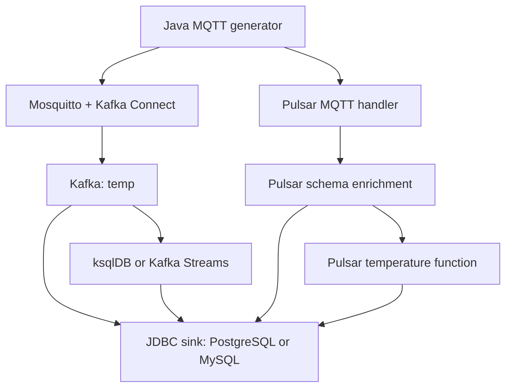

# Kafka vs. Pulsar for IoT Data Handling

A Docker-based benchmark for comparing Apache Kafka and Apache Pulsar in MQTT-based IoT data pipelines. The project includes a configurable Java MQTT load generator, optional temperature processing, PostgreSQL/MySQL persistence, SQL latency analysis, and Prometheus/Grafana monitoring.


The experiments compare complete **MQTT-to-database pipelines** on a single host. They examine database choice, message size, processing method, and production rate, using latency and CPU/memory measurements. The two systems implement comparable application flows through different components, the results should be interpreted for these configurations.

## What is included

| Directory | Contents |
| --- | --- |
| `modules/mqtt-load-generator/` | Java 17 MQTT workload generator, one connection/thread per producer, QoS 0 |
| `modules/kafka-streams/` | Java Fahrenheit-to-Celsius transformation and Confluent JSON Schema output |
| `modules/pulsar-functions/` | Publish-time enrichment, optional temperature conversion, explicit MQTT JSON input SerDe |
| `deployment/kafka/` | Kafka, ZooKeeper, Mosquitto, Connect, Schema Registry, connector templates, ksqlDB query |
| `deployment/pulsar/` | Pulsar standalone, MQTT protocol handler configuration, JDBC sink templates |
| `sql/` | PostgreSQL/MySQL tables and latency procedures for both platforms |
| `monitoring/` | Prometheus, cAdvisor, node-exporter and a Grafana dashboard |
| `experiments/runs.json` | Machine-readable definitions for R1-R19 |
| `scripts/` | Asset installation, build, trial lifecycle and result collection |
| `assets/runtime-manifest.json` | Sizes and SHA-256 checksums of companion runtime dependencies |

The full download includes `runtime-assets.zip` in the project root. It contains the connector, protocol-handler and JDBC dependencies required by the deployments. See [runtime dependencies](runtime/README.md) for installation.

## Pipeline architecture



Kafka Connect parses the generator's JSON, appends `kafka_timestamp`, and serializes a schema/payload envelope into `temp`. The baseline path persists those records directly. The processing alternatives convert Fahrenheit to Celsius and write to `processed_ksqldb_temp` or `processed_KafkaStreams_temp` before persistence.

Pulsar receives MQTT publications through its protocol handler. A schema-enrichment function runs in **every Pulsar scenario**, adding `pulsar_timestamp` and producing `temp_schema`. R12 additionally converts temperature and produces `processed_temp`. Thus, “baseline” means no optional temperature processing; it does not remove Pulsar's enrichment stage.

## Experimental scenarios

The experiments follow **Section 4, Tables 4 and 5** of *A Comparative Study of Apache Kafka and Apache Pulsar for IoT Data Handling*. The six test cases are implemented by the following 19 runs.

| Case | Question | Runs |
| --- | --- | --- |
| TC1 | Baseline MQTT ingestion and PostgreSQL persistence | R1-R2 |
| TC2 | Effect of replacing PostgreSQL with MySQL | R3-R4, compared with R1-R2 |
| TC3 | Effect of size settings 512, 1024 and 2048 at 100 messages/s | R5-R10 |
| TC4 | Kafka processing with ksqlDB or Kafka Streams | R11, R13 |
| TC5 | Pulsar processing with Pulsar Functions | [R12](#r12-pulsar-temperature-processing-with-functions) |
| TC6 | Effect of 1,000, 2,000 and 4,000 messages/s | R14-R19 |

| Run | Case | Platform | Processing path | Sink | Paper size label / CLI setting | Nominal messages/s |
| --- | --- | --- | --- | --- | --- | --- |
| [R1](#r1-kafka-baseline-with-postgresql) | TC1 | Kafka | Schema/ingestion only | PostgreSQL | 130 | 100 |
| [R2](#r2-pulsar-baseline-with-postgresql) | TC1 | Pulsar | Schema/ingestion only | PostgreSQL | 130 | 100 |
| [R3](#r3-kafka-baseline-with-mysql) | TC2 | Kafka | Schema/ingestion only | MySQL | 130 | 100 |
| [R4](#r4-pulsar-baseline-with-mysql) | TC2 | Pulsar | Schema/ingestion only | MySQL | 130 | 100 |
| [R5](#r5-kafka-with-payload-setting-512) | TC3 | Kafka | Schema/ingestion only | PostgreSQL | 512 | 100 |
| [R6](#r6-pulsar-with-payload-setting-512) | TC3 | Pulsar | Schema/ingestion only | PostgreSQL | 512 | 100 |
| [R7](#r7-kafka-with-payload-setting-1024) | TC3 | Kafka | Schema/ingestion only | PostgreSQL | 1024 | 100 |
| [R8](#r8-pulsar-with-payload-setting-1024) | TC3 | Pulsar | Schema/ingestion only | PostgreSQL | 1024 | 100 |
| [R9](#r9-kafka-with-payload-setting-2048) | TC3 | Kafka | Schema/ingestion only | PostgreSQL | 2048 | 100 |
| [R10](#r10-pulsar-with-payload-setting-2048) | TC3 | Pulsar | Schema/ingestion only | PostgreSQL | 2048 | 100 |
| [R11](#r11-kafka-temperature-processing-with-ksqldb) | TC4 | Kafka | ksqlDB | PostgreSQL | 130 | 100 |
| R12 | TC5 | Pulsar | Pulsar Functions | PostgreSQL | 130 | 100 |
| [R13](#r13-kafka-temperature-processing-with-streams) | TC4 | Kafka | Kafka Streams | PostgreSQL | 130 | 100 |
| [R14](#r14-pulsar-at-1000-messages-per-second) | TC6 | Pulsar | Schema/ingestion only | PostgreSQL | 130 | 1,000 |
| [R15](#r15-kafka-at-1000-messages-per-second) | TC6 | Kafka | Schema/ingestion only | PostgreSQL | 130 | 1,000 |
| [R16](#r16-pulsar-at-2000-messages-per-second) | TC6 | Pulsar | Schema/ingestion only | PostgreSQL | 130 | 2,000 |
| [R17](#r17-kafka-at-2000-messages-per-second) | TC6 | Kafka | Schema/ingestion only | PostgreSQL | 130 | 2,000 |
| [R18](#r18-pulsar-at-4000-messages-per-second) | TC6 | Pulsar | Schema/ingestion only | PostgreSQL | 130 | 4,000 |
| [R19](#r19-kafka-at-4000-messages-per-second) | TC6 | Kafka | Schema/ingestion only | PostgreSQL | 130 | 4,000 |

The paper labels message sizes in bytes. The Java generator implements `--payload-size` by creating `max(0, setting - 130)` ASCII filler characters; the complete JSON size is not guaranteed to equal the argument. Use the settings below to execute each scenario, and measure actual serialized UTF-8 sizes when interpreting size-dependent results.

The workload generator uses the following schedules:

| Nominal rate | Producers | Messages per producer | Delay per producer | Attempted total |
| --- | --- | --- | --- | --- |
| 100/s | 100 | 600 | 1000 ms | 60,000 |
| 1,000/s | 1000 | 600 | 1000 ms | 600,000 |
| 2,000/s | 1000 | 1200 | 500 ms | 1,200,000 |
| 4,000/s | 1000 | 2400 | 250 ms | 2,400,000 |

Each full workload lasts approximately ten minutes, plus connection jitter, publish overhead and drain time. Rates are targets (`producers * 1000 / delay_ms`), not measured throughput. Table 5 specifies size/rate/database/processing; concurrency and duration above come from the supplied execution guides. Set and record the repetition count and warm-up interval for your experiment. See [experiment details](docs/EXPERIMENTS.md).

## Requirements and setup

- JDK 17+ and Maven 3.8.6+ to build the application JARs.
- Python 3.10+; the operator scripts use its standard library.
- Docker Engine or Docker Desktop with the Compose v2 plugin.
- Internet access for container images and Maven dependencies.
- The matching `runtime-assets.zip` dependency archive.

The paper's testbed is an **AMD Ryzen 5 5625U, 6 cores/12 threads at 2.30 GHz, 16 GB RAM, Windows 11 Home**, using Docker Compose. Other hardware or container limits can change results. Linux-host monitoring requires the cAdvisor host paths/devices in `deployment/monitoring.yaml`; Docker Desktop metrics describe its Linux VM/container environment.

Clone the repository, or extract a ZIP and open a terminal in the folder containing this `README.md`:

```bash
git clone https://github.com/spartakos87/kafka_vs_pulsar.git
cd kafka_vs_pulsar
```

Place `runtime-assets.zip` in the project root. It is already included there in the full ZIP. Install the dependencies and build the Java modules:

```bash
cp .env.example .env
python3 scripts/import-runtime-assets.py runtime-assets.zip
./scripts/build.sh
```

Review `.env` before running. Some container images use `latest` tags. Pin known digests when reproducing an archived configuration. Only one trial should run at a time because the two testbeds use common host ports.

## First run: a small functional smoke test

Inspect a run without starting Docker:

```bash
python3 scripts/experiment.py R1 plan
```

Then execute a **20-message smoke test**, using the same pipeline but a smaller workload:

```bash
python3 scripts/experiment.py R1 up --smoke --no-monitoring
python3 scripts/experiment.py R1 configure
python3 scripts/experiment.py R1 run
python3 scripts/experiment.py R1 collect
python3 scripts/experiment.py R1 down
```

`configure` waits for database/broker readiness and deploys only the connectors and processor selected for that run. `run` waits for the expected database row count after publishing. An incomplete delivery count causes a nonzero exit; still execute `collect` to retain diagnostic evidence. A smoke test is not a paper experiment and is labeled accordingly in its manifest.

## Run-by-run execution instructions

Complete [Requirements and setup](#requirements-and-setup) once before following a run below. Execute every command from the project root, where `README.md`, `.env` and `scripts/` are located. Each subsection contains the complete command sequence for that particular run; its workload settings are selected automatically from `experiments/runs.json`.

### Execution sequence used by every run

| Step | Command action | What it does |
| --- | --- | --- |
| 1 | `plan` | Print and review the selected platform, database, processing mode and workload parameters. |
| 2 | `up` | Build the required application image and start a fresh, isolated trial with the selected database and monitoring. |
| 3 | `configure` | Wait for readiness; deploy the MQTT source/enrichment, the selected JDBC sink and any selected temperature processor. |
| 4 | `run --drain-timeout 180` | Publish the full workload, then wait up to 180 additional seconds for the expected unique database row count. |
| 5 | `collect` | Save the latency summary, persisted rows, service status/logs, image metadata and available CPU/memory time series. |
| 6 | `down` | Stop that trial after collection, preserving exported results and database volumes. |

Run one experiment at a time. Wait for each command to finish, and complete `collect` and `down` before starting the next experiment. If `configure` fails, resolve the readiness/configuration error before publishing. If `run` reports an incomplete row count, execute `collect` and preserve the failure evidence before stopping; a zero generator exit code alone does not prove delivery.

The commands below use full workloads with monitoring enabled. Each workload takes approximately ten minutes plus startup and drain time. Payload values are the generator's size arguments, and rates are nominal targets as explained in [Experimental scenarios](#experimental-scenarios). The expected row counts are completion checks, not a guarantee of delivery under QoS 0.

### R1: Kafka baseline with PostgreSQL

**Purpose (TC1):** Establish the Kafka baseline for MQTT ingestion and PostgreSQL persistence, with schema attachment and no optional temperature conversion.

**Workload:** 100 producers, 600 messages per producer, 1,000 ms delay, `--payload-size=130`; 100 nominal messages/s and 60,000 attempted messages.

**Pipeline:** The MQTT source connector reads `mqtt/temp` and writes schema-enabled records to Kafka topic `temp`. The raw JDBC sink consumes `temp` and writes to `kafka_to_db_temp` in PostgreSQL.

**Sink configuration:** [`deployment/kafka/connectors/jdbc_sink_temp_raw_postgres.json`](deployment/kafka/connectors/jdbc_sink_temp_raw_postgres.json). The runner supplies the local password and selects only this sink for the trial.

Run the following commands in order:

```bash
python3 scripts/experiment.py R1 plan
python3 scripts/experiment.py R1 up
python3 scripts/experiment.py R1 configure
python3 scripts/experiment.py R1 run --drain-timeout 180
python3 scripts/experiment.py R1 collect
python3 scripts/experiment.py R1 down
```

**Check the result:** the runner expects **60,000 unique rows** in `kafka_to_db_temp`. Open `results/R1/<UTC-instance>/latency.csv` for the average, median, p90, p95 and p99 pipeline delays, and `rows.csv` in the same directory to inspect the persisted messages. Check that `message_id`, `timestamp` and `kafka_timestamp` are present.

Compare with R2 for the platform comparison and R3 for the Kafka database comparison.

### R2: Pulsar baseline with PostgreSQL

**Purpose (TC1):** Establish the Pulsar baseline for MQTT ingestion and PostgreSQL persistence. The mandatory schema-enrichment function runs before the raw JDBC sink.

**Workload:** 100 producers, 600 messages per producer, 1,000 ms delay, `--payload-size=130`; 100 nominal messages/s and 60,000 attempted messages.

**Pipeline:** The MQTT handler receives `persistent://public/default/temp`; `temp-schema-fn` enriches it and writes `persistent://public/default/temp_schema`. The raw JDBC sink consumes `persistent://public/default/temp_schema` and writes to `pulsar_to_db_temp` in PostgreSQL.

**Sink configuration:** [`deployment/pulsar/sinks/jdbc_sink_pulsar_to_postgres_temp.json`](deployment/pulsar/sinks/jdbc_sink_pulsar_to_postgres_temp.json). The runner supplies the local password and selects only this sink for the trial.

Run the following commands in order:

```bash
python3 scripts/experiment.py R2 plan
python3 scripts/experiment.py R2 up
python3 scripts/experiment.py R2 configure
python3 scripts/experiment.py R2 run --drain-timeout 180
python3 scripts/experiment.py R2 collect
python3 scripts/experiment.py R2 down
```

**Check the result:** the runner expects **60,000 unique rows** in `pulsar_to_db_temp`. Open `results/R2/<UTC-instance>/latency.csv` for the average, median, p90, p95 and p99 pipeline delays, and `rows.csv` in the same directory to inspect the persisted messages. Check that `message_id`, `timestamp` and `pulsar_timestamp` are present.

Compare with R1 for the platform comparison and R4 for the Pulsar database comparison.

### R3: Kafka baseline with MySQL

**Purpose (TC2):** Measure the effect of using MySQL as the Kafka sink while keeping the baseline workload unchanged.

**Workload:** 100 producers, 600 messages per producer, 1,000 ms delay, `--payload-size=130`; 100 nominal messages/s and 60,000 attempted messages.

**Pipeline:** The MQTT source connector reads `mqtt/temp` and writes schema-enabled records to Kafka topic `temp`. The raw JDBC sink consumes `temp` and writes to `kafka_to_db_temp` in MySQL.

**Sink configuration:** [`deployment/kafka/connectors/jdbc_sink_temp_raw_mysql.json`](deployment/kafka/connectors/jdbc_sink_temp_raw_mysql.json). The runner supplies the local password and selects only this sink for the trial.

Run the following commands in order:

```bash
python3 scripts/experiment.py R3 plan
python3 scripts/experiment.py R3 up
python3 scripts/experiment.py R3 configure
python3 scripts/experiment.py R3 run --drain-timeout 180
python3 scripts/experiment.py R3 collect
python3 scripts/experiment.py R3 down
```

**Check the result:** the runner expects **60,000 unique rows** in `kafka_to_db_temp`. Open `results/R3/<UTC-instance>/latency.tsv` for the average, median, p90, p95 and p99 pipeline delays, and `rows.tsv` in the same directory to inspect the persisted messages. Check that `message_id`, `timestamp` and `kafka_timestamp` are present.

Compare with R1 to isolate the Kafka database change, and with R4 to compare the platforms with MySQL.

### R4: Pulsar baseline with MySQL

**Purpose (TC2):** Measure the effect of using MySQL as the Pulsar sink while retaining mandatory schema enrichment and the baseline workload.

**Workload:** 100 producers, 600 messages per producer, 1,000 ms delay, `--payload-size=130`; 100 nominal messages/s and 60,000 attempted messages.

**Pipeline:** The MQTT handler receives `persistent://public/default/temp`; `temp-schema-fn` enriches it and writes `persistent://public/default/temp_schema`. The raw JDBC sink consumes `persistent://public/default/temp_schema` and writes to `pulsar_to_db_temp` in MySQL.

**Sink configuration:** [`deployment/pulsar/sinks/jdbc_sink_pulsar_to_mysql_temp.json`](deployment/pulsar/sinks/jdbc_sink_pulsar_to_mysql_temp.json). The runner supplies the local password and selects only this sink for the trial.

Run the following commands in order:

```bash
python3 scripts/experiment.py R4 plan
python3 scripts/experiment.py R4 up
python3 scripts/experiment.py R4 configure
python3 scripts/experiment.py R4 run --drain-timeout 180
python3 scripts/experiment.py R4 collect
python3 scripts/experiment.py R4 down
```

**Check the result:** the runner expects **60,000 unique rows** in `pulsar_to_db_temp`. Open `results/R4/<UTC-instance>/latency.tsv` for the average, median, p90, p95 and p99 pipeline delays, and `rows.tsv` in the same directory to inspect the persisted messages. Check that `message_id`, `timestamp` and `pulsar_timestamp` are present.

Compare with R2 to isolate the Pulsar database change, and with R3 to compare the platforms with MySQL.

### R5: Kafka with payload setting 512

**Purpose (TC3):** Evaluate Kafka with a larger message-size setting while retaining PostgreSQL and a nominal rate of 100 messages/s.

**Workload:** 100 producers, 600 messages per producer, 1,000 ms delay, `--payload-size=512`; 100 nominal messages/s and 60,000 attempted messages.

**Pipeline:** The MQTT source connector reads `mqtt/temp` and writes schema-enabled records to Kafka topic `temp`. The raw JDBC sink consumes `temp` and writes to `kafka_to_db_temp` in PostgreSQL.

**Sink configuration:** [`deployment/kafka/connectors/jdbc_sink_temp_raw_postgres.json`](deployment/kafka/connectors/jdbc_sink_temp_raw_postgres.json). The runner supplies the local password and selects only this sink for the trial.

Run the following commands in order:

```bash
python3 scripts/experiment.py R5 plan
python3 scripts/experiment.py R5 up
python3 scripts/experiment.py R5 configure
python3 scripts/experiment.py R5 run --drain-timeout 180
python3 scripts/experiment.py R5 collect
python3 scripts/experiment.py R5 down
```

**Check the result:** the runner expects **60,000 unique rows** in `kafka_to_db_temp`. Open `results/R5/<UTC-instance>/latency.csv` for the average, median, p90, p95 and p99 pipeline delays, and `rows.csv` in the same directory to inspect the persisted messages. Check that `message_id`, `timestamp` and `kafka_timestamp` are present.

Compare with R7 and R9 for Kafka size variation, and with R6 for the same setting on Pulsar.

### R6: Pulsar with payload setting 512

**Purpose (TC3):** Evaluate Pulsar with a larger message-size setting while retaining PostgreSQL, mandatory enrichment and a nominal rate of 100 messages/s.

**Workload:** 100 producers, 600 messages per producer, 1,000 ms delay, `--payload-size=512`; 100 nominal messages/s and 60,000 attempted messages.

**Pipeline:** The MQTT handler receives `persistent://public/default/temp`; `temp-schema-fn` enriches it and writes `persistent://public/default/temp_schema`. The raw JDBC sink consumes `persistent://public/default/temp_schema` and writes to `pulsar_to_db_temp` in PostgreSQL.

**Sink configuration:** [`deployment/pulsar/sinks/jdbc_sink_pulsar_to_postgres_temp.json`](deployment/pulsar/sinks/jdbc_sink_pulsar_to_postgres_temp.json). The runner supplies the local password and selects only this sink for the trial.

Run the following commands in order:

```bash
python3 scripts/experiment.py R6 plan
python3 scripts/experiment.py R6 up
python3 scripts/experiment.py R6 configure
python3 scripts/experiment.py R6 run --drain-timeout 180
python3 scripts/experiment.py R6 collect
python3 scripts/experiment.py R6 down
```

**Check the result:** the runner expects **60,000 unique rows** in `pulsar_to_db_temp`. Open `results/R6/<UTC-instance>/latency.csv` for the average, median, p90, p95 and p99 pipeline delays, and `rows.csv` in the same directory to inspect the persisted messages. Check that `message_id`, `timestamp` and `pulsar_timestamp` are present.

Compare with R8 and R10 for Pulsar size variation, and with R5 for the same setting on Kafka.

### R7: Kafka with payload setting 1024

**Purpose (TC3):** Increase the Kafka message-size setting to 1024 while keeping the database, producer count and nominal rate fixed.

**Workload:** 100 producers, 600 messages per producer, 1,000 ms delay, `--payload-size=1024`; 100 nominal messages/s and 60,000 attempted messages.

**Pipeline:** The MQTT source connector reads `mqtt/temp` and writes schema-enabled records to Kafka topic `temp`. The raw JDBC sink consumes `temp` and writes to `kafka_to_db_temp` in PostgreSQL.

**Sink configuration:** [`deployment/kafka/connectors/jdbc_sink_temp_raw_postgres.json`](deployment/kafka/connectors/jdbc_sink_temp_raw_postgres.json). The runner supplies the local password and selects only this sink for the trial.

Run the following commands in order:

```bash
python3 scripts/experiment.py R7 plan
python3 scripts/experiment.py R7 up
python3 scripts/experiment.py R7 configure
python3 scripts/experiment.py R7 run --drain-timeout 180
python3 scripts/experiment.py R7 collect
python3 scripts/experiment.py R7 down
```

**Check the result:** the runner expects **60,000 unique rows** in `kafka_to_db_temp`. Open `results/R7/<UTC-instance>/latency.csv` for the average, median, p90, p95 and p99 pipeline delays, and `rows.csv` in the same directory to inspect the persisted messages. Check that `message_id`, `timestamp` and `kafka_timestamp` are present.

Compare with R5 and R9 for Kafka size variation, and with R8 for the matching Pulsar configuration.

### R8: Pulsar with payload setting 1024

**Purpose (TC3):** Increase the Pulsar message-size setting to 1024 while keeping the database, enrichment path and nominal rate fixed.

**Workload:** 100 producers, 600 messages per producer, 1,000 ms delay, `--payload-size=1024`; 100 nominal messages/s and 60,000 attempted messages.

**Pipeline:** The MQTT handler receives `persistent://public/default/temp`; `temp-schema-fn` enriches it and writes `persistent://public/default/temp_schema`. The raw JDBC sink consumes `persistent://public/default/temp_schema` and writes to `pulsar_to_db_temp` in PostgreSQL.

**Sink configuration:** [`deployment/pulsar/sinks/jdbc_sink_pulsar_to_postgres_temp.json`](deployment/pulsar/sinks/jdbc_sink_pulsar_to_postgres_temp.json). The runner supplies the local password and selects only this sink for the trial.

Run the following commands in order:

```bash
python3 scripts/experiment.py R8 plan
python3 scripts/experiment.py R8 up
python3 scripts/experiment.py R8 configure
python3 scripts/experiment.py R8 run --drain-timeout 180
python3 scripts/experiment.py R8 collect
python3 scripts/experiment.py R8 down
```

**Check the result:** the runner expects **60,000 unique rows** in `pulsar_to_db_temp`. Open `results/R8/<UTC-instance>/latency.csv` for the average, median, p90, p95 and p99 pipeline delays, and `rows.csv` in the same directory to inspect the persisted messages. Check that `message_id`, `timestamp` and `pulsar_timestamp` are present.

Compare with R6 and R10 for Pulsar size variation, and with R7 for the matching Kafka configuration.

### R9: Kafka with payload setting 2048

**Purpose (TC3):** Execute the largest Kafka message-size setting in TC3 at the same PostgreSQL sink and nominal rate.

**Workload:** 100 producers, 600 messages per producer, 1,000 ms delay, `--payload-size=2048`; 100 nominal messages/s and 60,000 attempted messages.

**Pipeline:** The MQTT source connector reads `mqtt/temp` and writes schema-enabled records to Kafka topic `temp`. The raw JDBC sink consumes `temp` and writes to `kafka_to_db_temp` in PostgreSQL.

**Sink configuration:** [`deployment/kafka/connectors/jdbc_sink_temp_raw_postgres.json`](deployment/kafka/connectors/jdbc_sink_temp_raw_postgres.json). The runner supplies the local password and selects only this sink for the trial.

Run the following commands in order:

```bash
python3 scripts/experiment.py R9 plan
python3 scripts/experiment.py R9 up
python3 scripts/experiment.py R9 configure
python3 scripts/experiment.py R9 run --drain-timeout 180
python3 scripts/experiment.py R9 collect
python3 scripts/experiment.py R9 down
```

**Check the result:** the runner expects **60,000 unique rows** in `kafka_to_db_temp`. Open `results/R9/<UTC-instance>/latency.csv` for the average, median, p90, p95 and p99 pipeline delays, and `rows.csv` in the same directory to inspect the persisted messages. Check that `message_id`, `timestamp` and `kafka_timestamp` are present.

Compare with R5 and R7 for Kafka size variation, and with R10 for the matching Pulsar configuration.

### R10: Pulsar with payload setting 2048

**Purpose (TC3):** Execute the largest Pulsar message-size setting in TC3 at the same PostgreSQL sink, enrichment path and nominal rate.

**Workload:** 100 producers, 600 messages per producer, 1,000 ms delay, `--payload-size=2048`; 100 nominal messages/s and 60,000 attempted messages.

**Pipeline:** The MQTT handler receives `persistent://public/default/temp`; `temp-schema-fn` enriches it and writes `persistent://public/default/temp_schema`. The raw JDBC sink consumes `persistent://public/default/temp_schema` and writes to `pulsar_to_db_temp` in PostgreSQL.

**Sink configuration:** [`deployment/pulsar/sinks/jdbc_sink_pulsar_to_postgres_temp.json`](deployment/pulsar/sinks/jdbc_sink_pulsar_to_postgres_temp.json). The runner supplies the local password and selects only this sink for the trial.

Run the following commands in order:

```bash
python3 scripts/experiment.py R10 plan
python3 scripts/experiment.py R10 up
python3 scripts/experiment.py R10 configure
python3 scripts/experiment.py R10 run --drain-timeout 180
python3 scripts/experiment.py R10 collect
python3 scripts/experiment.py R10 down
```

**Check the result:** the runner expects **60,000 unique rows** in `pulsar_to_db_temp`. Open `results/R10/<UTC-instance>/latency.csv` for the average, median, p90, p95 and p99 pipeline delays, and `rows.csv` in the same directory to inspect the persisted messages. Check that `message_id`, `timestamp` and `pulsar_timestamp` are present.

Compare with R6 and R8 for Pulsar size variation, and with R9 for the matching Kafka configuration.

### R11: Kafka temperature processing with ksqlDB

**Purpose (TC4):** Measure Kafka end-to-end and intermediate delays when ksqlDB performs Fahrenheit-to-Celsius conversion before PostgreSQL persistence.

**Workload:** 100 producers, 600 messages per producer, 1,000 ms delay, `--payload-size=130`; 100 nominal messages/s and 60,000 attempted messages.

**Pipeline:** The MQTT source connector reads `mqtt/temp` and writes schema-enabled records to Kafka topic `temp`. The selected ksqlDB service executes [`deployment/kafka/ksqldb/init.sql`](deployment/kafka/ksqldb/init.sql), reads `temp` and writes `processed_ksqldb_temp`. The JDBC sink consumes that exact output topic.

**Sink configuration:** [`deployment/kafka/connectors/jdbc_sink_temp_processed_postgres.json`](deployment/kafka/connectors/jdbc_sink_temp_processed_postgres.json). The runner supplies the local password and selects only this sink for the trial.

Run the following commands in order:

```bash
python3 scripts/experiment.py R11 plan
python3 scripts/experiment.py R11 up
python3 scripts/experiment.py R11 configure
python3 scripts/experiment.py R11 run --drain-timeout 180
python3 scripts/experiment.py R11 collect
python3 scripts/experiment.py R11 down
```

**Check the result:** the runner expects **60,000 unique rows** in `kafka_processed_to_db_temp`. Open `results/R11/<UTC-instance>/latency.csv` for the average, median, p90, p95 and p99 pipeline delays, and `rows.csv` in the same directory to inspect the persisted messages. Check that `UPDATED_TEMPERATURE_CELSIUS` equals `(TEMPERATURE_FAHRENHEIT - 32) * 5 / 9` within floating-point precision and that IDs and timestamps are present.

Compare with R13 for the Kafka processing-engine comparison, R12 for the Pulsar processing pipeline, and R1 for the Kafka ingestion baseline.

### R12: Pulsar temperature processing with Functions

**Purpose (TC5):** Measure the complete Pulsar processing path: schema enrichment, a second function for Fahrenheit-to-Celsius conversion, and PostgreSQL persistence.

**Workload:** 100 producers, 600 messages per producer, 1,000 ms delay, `--payload-size=130`; 100 nominal messages/s and 60,000 attempted messages.

**Pipeline:** The MQTT handler receives `persistent://public/default/temp`; `temp-schema-fn` enriches it and writes `persistent://public/default/temp_schema`. The additional `temp-processing-fn` converts the temperature and writes `persistent://public/default/processed_temp`, which is consumed by the selected JDBC sink.

**Sink configuration:** [`deployment/pulsar/sinks/jdbc_sink_pulsar_functions_to_postgres_temp.json`](deployment/pulsar/sinks/jdbc_sink_pulsar_functions_to_postgres_temp.json). The runner supplies the local password and selects only this sink for the trial.

Run the following commands in order:

```bash
python3 scripts/experiment.py R12 plan
python3 scripts/experiment.py R12 up
python3 scripts/experiment.py R12 configure
python3 scripts/experiment.py R12 run --drain-timeout 180
python3 scripts/experiment.py R12 collect
python3 scripts/experiment.py R12 down
```

**Check the result:** the runner expects **60,000 unique rows** in `pulsar_processed_to_db_temp`. Open `results/R12/<UTC-instance>/latency.csv` for the average, median, p90, p95 and p99 pipeline delays, and `rows.csv` in the same directory to inspect the persisted messages. Check that `updated_temperature_celsius` equals `(temperature_fahrenheit - 32) * 5 / 9` within floating-point precision and that IDs and timestamps are present.

Compare with R2 for the effect of optional Pulsar processing, and with R11/R13 for the other processing pipelines.

### R13: Kafka temperature processing with Streams

**Purpose (TC4):** Measure the Kafka processing path when the Java Kafka Streams application performs Fahrenheit-to-Celsius conversion before PostgreSQL persistence.

**Workload:** 100 producers, 600 messages per producer, 1,000 ms delay, `--payload-size=130`; 100 nominal messages/s and 60,000 attempted messages.

**Pipeline:** The MQTT source connector reads `mqtt/temp` and writes schema-enabled records to Kafka topic `temp`. The selected `kafka-streams` service runs `org.example.KafkaStreamsProcessors`, reads `temp` and writes `processed_KafkaStreams_temp`. The JDBC sink consumes that exact output topic.

**Sink configuration:** [`deployment/kafka/connectors/jdbc_sink_temp_processed_postgres.json`](deployment/kafka/connectors/jdbc_sink_temp_processed_postgres.json). The runner supplies the local password and selects only this sink for the trial.

Run the following commands in order:

```bash
python3 scripts/experiment.py R13 plan
python3 scripts/experiment.py R13 up
python3 scripts/experiment.py R13 configure
python3 scripts/experiment.py R13 run --drain-timeout 180
python3 scripts/experiment.py R13 collect
python3 scripts/experiment.py R13 down
```

**Check the result:** the runner expects **60,000 unique rows** in `kafka_processed_to_db_temp`. Open `results/R13/<UTC-instance>/latency.csv` for the average, median, p90, p95 and p99 pipeline delays, and `rows.csv` in the same directory to inspect the persisted messages. Check that `UPDATED_TEMPERATURE_CELSIUS` equals `(TEMPERATURE_FAHRENHEIT - 32) * 5 / 9` within floating-point precision and that IDs and timestamps are present.

Compare with R11 for the Kafka processing-engine comparison, R12 for the Pulsar processing pipeline, and R1 for the Kafka ingestion baseline.

### R14: Pulsar at 1000 messages per second

**Purpose (TC6):** Evaluate the first higher-rate Pulsar workload using PostgreSQL, size setting 130 and mandatory schema enrichment.

**Workload:** 1,000 producers, 600 messages per producer, 1,000 ms delay, `--payload-size=130`; 1,000 nominal messages/s and 600,000 attempted messages.

**Pipeline:** The MQTT handler receives `persistent://public/default/temp`; `temp-schema-fn` enriches it and writes `persistent://public/default/temp_schema`. The raw JDBC sink consumes `persistent://public/default/temp_schema` and writes to `pulsar_to_db_temp` in PostgreSQL.

**Sink configuration:** [`deployment/pulsar/sinks/jdbc_sink_pulsar_to_postgres_temp.json`](deployment/pulsar/sinks/jdbc_sink_pulsar_to_postgres_temp.json). The runner supplies the local password and selects only this sink for the trial.

Run the following commands in order:

```bash
python3 scripts/experiment.py R14 plan
python3 scripts/experiment.py R14 up
python3 scripts/experiment.py R14 configure
python3 scripts/experiment.py R14 run --drain-timeout 180
python3 scripts/experiment.py R14 collect
python3 scripts/experiment.py R14 down
```

**Check the result:** the runner expects **600,000 unique rows** in `pulsar_to_db_temp`. Open `results/R14/<UTC-instance>/latency.csv` for the average, median, p90, p95 and p99 pipeline delays, and `rows.csv` in the same directory to inspect the persisted messages. Check that `message_id`, `timestamp` and `pulsar_timestamp` are present.

Compare with R16 and R18 to assess higher rates on Pulsar, and with R15 at the matching Kafka rate.

### R15: Kafka at 1000 messages per second

**Purpose (TC6):** Evaluate the first higher-rate Kafka workload using PostgreSQL, size setting 130 and the ingestion-only path.

**Workload:** 1,000 producers, 600 messages per producer, 1,000 ms delay, `--payload-size=130`; 1,000 nominal messages/s and 600,000 attempted messages.

**Pipeline:** The MQTT source connector reads `mqtt/temp` and writes schema-enabled records to Kafka topic `temp`. The raw JDBC sink consumes `temp` and writes to `kafka_to_db_temp` in PostgreSQL.

**Sink configuration:** [`deployment/kafka/connectors/jdbc_sink_temp_raw_postgres.json`](deployment/kafka/connectors/jdbc_sink_temp_raw_postgres.json). The runner supplies the local password and selects only this sink for the trial.

Run the following commands in order:

```bash
python3 scripts/experiment.py R15 plan
python3 scripts/experiment.py R15 up
python3 scripts/experiment.py R15 configure
python3 scripts/experiment.py R15 run --drain-timeout 180
python3 scripts/experiment.py R15 collect
python3 scripts/experiment.py R15 down
```

**Check the result:** the runner expects **600,000 unique rows** in `kafka_to_db_temp`. Open `results/R15/<UTC-instance>/latency.csv` for the average, median, p90, p95 and p99 pipeline delays, and `rows.csv` in the same directory to inspect the persisted messages. Check that `message_id`, `timestamp` and `kafka_timestamp` are present.

Compare with R17 and R19 to assess higher rates on Kafka, and with R14 at the matching Pulsar rate.

### R16: Pulsar at 2000 messages per second

**Purpose (TC6):** Increase the nominal Pulsar rate to 2000 messages/s by reducing each producer delay to 500 ms and increasing messages per producer to 1200.

**Workload:** 1,000 producers, 1,200 messages per producer, 500 ms delay, `--payload-size=130`; 2,000 nominal messages/s and 1,200,000 attempted messages.

**Pipeline:** The MQTT handler receives `persistent://public/default/temp`; `temp-schema-fn` enriches it and writes `persistent://public/default/temp_schema`. The raw JDBC sink consumes `persistent://public/default/temp_schema` and writes to `pulsar_to_db_temp` in PostgreSQL.

**Sink configuration:** [`deployment/pulsar/sinks/jdbc_sink_pulsar_to_postgres_temp.json`](deployment/pulsar/sinks/jdbc_sink_pulsar_to_postgres_temp.json). The runner supplies the local password and selects only this sink for the trial.

Run the following commands in order:

```bash
python3 scripts/experiment.py R16 plan
python3 scripts/experiment.py R16 up
python3 scripts/experiment.py R16 configure
python3 scripts/experiment.py R16 run --drain-timeout 180
python3 scripts/experiment.py R16 collect
python3 scripts/experiment.py R16 down
```

**Check the result:** the runner expects **1,200,000 unique rows** in `pulsar_to_db_temp`. Open `results/R16/<UTC-instance>/latency.csv` for the average, median, p90, p95 and p99 pipeline delays, and `rows.csv` in the same directory to inspect the persisted messages. Check that `message_id`, `timestamp` and `pulsar_timestamp` are present.

Compare with R14 and R18 for Pulsar rate sensitivity, and with R17 for the same nominal rate on Kafka.

### R17: Kafka at 2000 messages per second

**Purpose (TC6):** Increase the nominal Kafka rate to 2000 messages/s by reducing each producer delay to 500 ms and increasing messages per producer to 1200.

**Workload:** 1,000 producers, 1,200 messages per producer, 500 ms delay, `--payload-size=130`; 2,000 nominal messages/s and 1,200,000 attempted messages.

**Pipeline:** The MQTT source connector reads `mqtt/temp` and writes schema-enabled records to Kafka topic `temp`. The raw JDBC sink consumes `temp` and writes to `kafka_to_db_temp` in PostgreSQL.

**Sink configuration:** [`deployment/kafka/connectors/jdbc_sink_temp_raw_postgres.json`](deployment/kafka/connectors/jdbc_sink_temp_raw_postgres.json). The runner supplies the local password and selects only this sink for the trial.

Run the following commands in order:

```bash
python3 scripts/experiment.py R17 plan
python3 scripts/experiment.py R17 up
python3 scripts/experiment.py R17 configure
python3 scripts/experiment.py R17 run --drain-timeout 180
python3 scripts/experiment.py R17 collect
python3 scripts/experiment.py R17 down
```

**Check the result:** the runner expects **1,200,000 unique rows** in `kafka_to_db_temp`. Open `results/R17/<UTC-instance>/latency.csv` for the average, median, p90, p95 and p99 pipeline delays, and `rows.csv` in the same directory to inspect the persisted messages. Check that `message_id`, `timestamp` and `kafka_timestamp` are present.

Compare with R15 and R19 for Kafka rate sensitivity, and with R16 for the same nominal rate on Pulsar.

### R18: Pulsar at 4000 messages per second

**Purpose (TC6):** Execute the highest nominal Pulsar rate in TC6 with 1000 producers, a 250 ms delay and 2400 messages per producer.

**Workload:** 1,000 producers, 2,400 messages per producer, 250 ms delay, `--payload-size=130`; 4,000 nominal messages/s and 2,400,000 attempted messages.

**Pipeline:** The MQTT handler receives `persistent://public/default/temp`; `temp-schema-fn` enriches it and writes `persistent://public/default/temp_schema`. The raw JDBC sink consumes `persistent://public/default/temp_schema` and writes to `pulsar_to_db_temp` in PostgreSQL.

**Sink configuration:** [`deployment/pulsar/sinks/jdbc_sink_pulsar_to_postgres_temp.json`](deployment/pulsar/sinks/jdbc_sink_pulsar_to_postgres_temp.json). The runner supplies the local password and selects only this sink for the trial.

Run the following commands in order:

```bash
python3 scripts/experiment.py R18 plan
python3 scripts/experiment.py R18 up
python3 scripts/experiment.py R18 configure
python3 scripts/experiment.py R18 run --drain-timeout 180
python3 scripts/experiment.py R18 collect
python3 scripts/experiment.py R18 down
```

**Check the result:** the runner expects **2,400,000 unique rows** in `pulsar_to_db_temp`. Open `results/R18/<UTC-instance>/latency.csv` for the average, median, p90, p95 and p99 pipeline delays, and `rows.csv` in the same directory to inspect the persisted messages. Check that `message_id`, `timestamp` and `pulsar_timestamp` are present.

Compare with R14 and R16 for Pulsar rate sensitivity, and with R19 for the matching Kafka workload.

### R19: Kafka at 4000 messages per second

**Purpose (TC6):** Execute the highest nominal Kafka rate in TC6 with 1000 producers, a 250 ms delay and 2400 messages per producer.

**Workload:** 1,000 producers, 2,400 messages per producer, 250 ms delay, `--payload-size=130`; 4,000 nominal messages/s and 2,400,000 attempted messages.

**Pipeline:** The MQTT source connector reads `mqtt/temp` and writes schema-enabled records to Kafka topic `temp`. The raw JDBC sink consumes `temp` and writes to `kafka_to_db_temp` in PostgreSQL.

**Sink configuration:** [`deployment/kafka/connectors/jdbc_sink_temp_raw_postgres.json`](deployment/kafka/connectors/jdbc_sink_temp_raw_postgres.json). The runner supplies the local password and selects only this sink for the trial.

Run the following commands in order:

```bash
python3 scripts/experiment.py R19 plan
python3 scripts/experiment.py R19 up
python3 scripts/experiment.py R19 configure
python3 scripts/experiment.py R19 run --drain-timeout 180
python3 scripts/experiment.py R19 collect
python3 scripts/experiment.py R19 down
```

**Check the result:** the runner expects **2,400,000 unique rows** in `kafka_to_db_temp`. Open `results/R19/<UTC-instance>/latency.csv` for the average, median, p90, p95 and p99 pipeline delays, and `rows.csv` in the same directory to inspect the persisted messages. Check that `message_id`, `timestamp` and `kafka_timestamp` are present.

Compare with R15 and R17 for Kafka rate sensitivity, and with R18 for the matching Pulsar workload.

## Inspect results

Results are saved under `results/<run>/<UTC-instance>/`:

- `manifest.json`: paper settings, actual workload, smoke/full label, times, attempted count and observed rows.
- `latency.csv` (PostgreSQL) or `latency.tsv` (MySQL): average, median, p90, p95 and p99 from the SQL procedures.
- `rows.csv` or `rows.tsv`: persisted records for independent analysis.
- `generator.log`, service logs and connector/function status.
- Image metadata/digests and optional Prometheus CPU/memory time series.

With monitoring enabled, open **Grafana at http://localhost:3000** (initial login `admin` / `admin`) or **Prometheus at http://localhost:9090**. Enter the active Compose project from the manifest into Grafana's `project` variable. Local captures marked `.local` and resolved configuration can contain trial credentials; review them before sharing results.

The database insertion timestamp is an application-level storage timestamp, not a durable-commit acknowledgement. Intermediate timestamp provenance, SQL percentile differences, QoS 0, upsert deduplication, and CPU/memory aggregation are explained in [measurement methodology](docs/MEASUREMENTS.md).

## Versions and validation

The deployment uses Confluent Platform images `7.7.0`, Pulsar `4.0.0`, MQTT handler `4.0.0.10`, PostgreSQL `14-alpine`, MySQL `8.0`, Kafka Connect JDBC `10.8.0`, and MQTT connector `1.7.3`. Application dependencies are Kafka Streams `3.6.0`, Confluent JSON Schema SerDe `7.9.0`, Jackson `2.16.0`, Pulsar Functions API `4.0.0`, Paho `1.2.5`, and Gson `2.8.9`. See [installation](docs/INSTALLATION.md) and [validation](docs/VALIDATION.md).

Validation covers the Maven build, operator tests and Compose configuration checks. Use the smoke test to verify actual data flow on your Docker host before executing full workloads. Original raw measurement data and historical image digests are not included. See [measurement scope and configuration notes](docs/REPRODUCIBILITY.md).

## Runtime dependency licenses

Third-party dependencies retain their own licenses and included notices. See [THIRD_PARTY_NOTICES.md](THIRD_PARTY_NOTICES.md) for the connector package license metadata.
